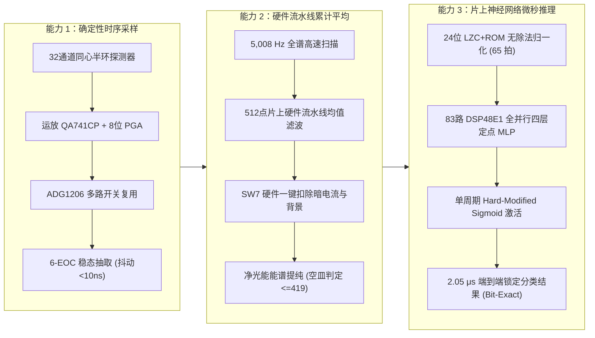
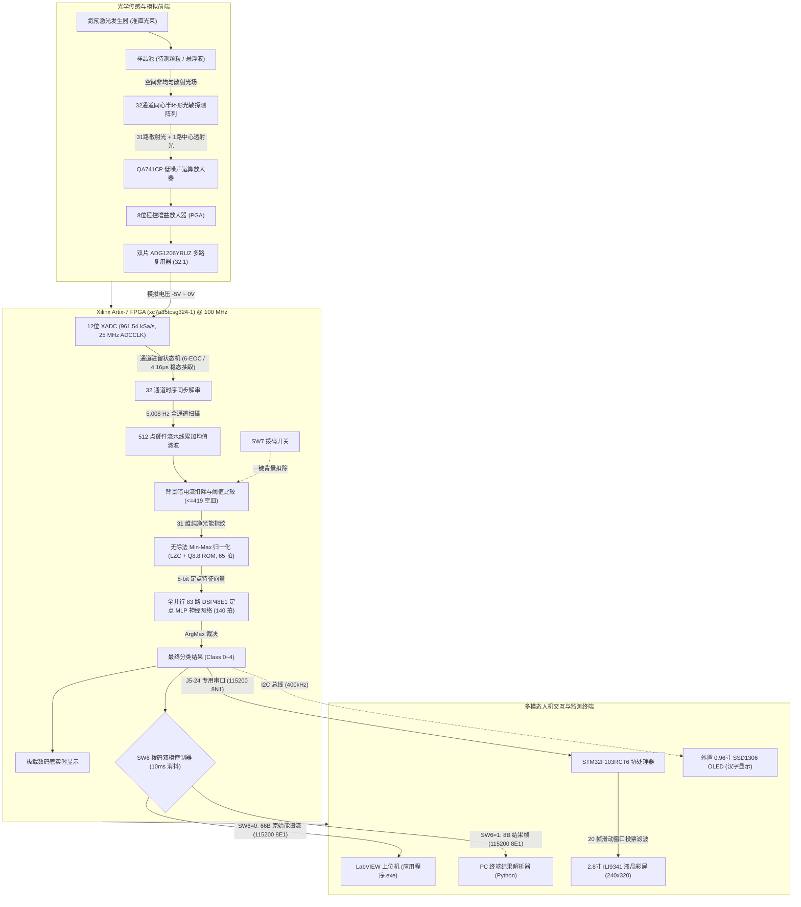

# 基于 FPGA 片上神经网络加速的实时激光粒度智能分析系统
### Real-Time Laser Particle Size Intelligent Analysis System with On-Chip FPGA Neural Acceleration

[](https://www.xilinx.com/)
[](https://www.xilinx.com/products/design-tools/vivado.html)
[](https://www.st.com/)
[]()
[-success.svg)]()
[]()

---

## 目录 (Table of Contents)

- [一、项目背景与三大核心突破](#一项目背景与三大核心突破)
- [二、开源范围与知识产权说明](#二开源范围与知识产权说明)
- [三、系统总体架构与工作原理](#三系统总体架构与工作原理)
- [四、FPGA 关键硬件算法与性能指标](#四fpga-关键硬件算法与性能指标)
  - [1. 确定性低抖动采样与硬件累加平均](#1-确定性低抖动采样与硬件累加平均)
  - [2. 无除法 LZC+ROM 动态归一化流水线](#2-无除法-lzcrom-动态归一化流水线)
  - [3. 空间全并行定点 MLP 推理引擎](#3-空间全并行定点-mlp-推理引擎)
  - [4. FPGA 片上资源利用率与时序报告](#4-fpga-片上资源利用率与时序报告)
- [五、双模通信协议与滑动窗口抗抖投票](#五双模通信协议与滑动窗口抗抖投票)
  - [1. SW6 双模式串口规范](#1-sw6-双模式串口规范)
  - [2. 协议 v2 数据包格式 (CRC-8/ATM)](#2-协议-v2-数据包格式-crc-8atm)
  - [3. STM32 20 帧滑动窗口滞后投票算法](#3-stm32-20-帧滑动窗口滞后投票算法)
- [六、代码仓库目录与文件清单](#六代码仓库目录与文件清单)
- [七、核心交付物速查表](#七核心交付物速查表)
- [八、快速复现与操作指南](#八快速复现与操作指南)
  - [1. 行为级时序仿真波形复现 (免 Vivado 编译)](#1-行为级时序仿真波形复现-免-vivado-编译)
  - [2. 神经网络 Web Canvas 动态交互推演系统](#2-神经网络-web-canvas-动态交互推演系统)
  - [3. LabVIEW 上位机免安装运行](#3-labview-上位机免安装运行)
  - [4. 硬件联调接线与固件烧录](#4-硬件联调接线与固件烧录)
  - [5. 3D 打印模块化机架装配](#5-3d-打印模块化机架装配)
- [九、素材版权与许可声明](#九素材版权与许可声明)

---

## 一、项目背景与三大核心突破

传统激光粒度分析仪多依赖低速单片机轮询采样与通用 PC 软件迭代求解 Fredholm 第一类病态积分方程。该方案受限于操作系统调度抖动大、能谱反演易发散、多重散射抗扰差及整机体积庞大，无法满足工业粉体在线流态监测、高危防爆分选以及便携嵌入式现场质检的严苛实时要求。

针对上述瓶颈，本项目研制了一套**基于 Xilinx Artix-7 FPGA（`xc7a35tcsg324-1`）片上神经网络全硬件加速的实时激光粒度智能分析系统**。系统通过三大核心能力彻底摆脱 PC 上位机参与实时运算的依赖，实现了微秒级端到端边缘智能闭环：



1. **确定性延迟采集 (Deterministic Latency Sampling)**：硬件时序状态机精准锁死模拟开关驻留周期，在单通道 6 个 EOC 周期（6.24 μs）窗口内固定等待运放建立 4.16 μs 后抽取稳态值，抖动 `<10 ns`，实现 160.26 kSa/s 无抖动有效采样与 5,008 Hz 的 32 环全通道超高速扫描。
2. **硬件流水线累计平均 (Hardware Pipeline Averaging)**：在 FPGA 片内实现连续 512 点高速流水线累加均值滤波，彻底压制光电闪烁噪声与悬浮颗粒布朗运动引起的随机高频扰动，大幅提纯稳定的 31 维光能散射指纹。
3. **片上神经网络微秒加速 (On-Chip Neural Network Acceleration)**：独创无除法 LZC+ROM 动态归一化流水线与全并行 83 路 DSP48E1 乘加阵列，单次分类推理仅耗时 **2.05 μs**，相比单帧数据采集周期（102.24 ms）提速超 **49,800 倍**，对肉眼无法区分的微米级同色粉体实现高达 **96.15%** 的高精度鉴别。


## 二、系统总体架构与工作原理

系统由前端光学准直光路、光电检测放大板、Xilinx Artix-7 FPGA 核心处理板、STM32 人机交互触控屏终端、LabVIEW PC 上位机以及 3D 打印模块化结构支架协同组成：



---

## 三、FPGA 关键硬件算法与性能指标

### 1. 确定性低抖动采样与硬件累加平均

- **XADC 模数转换基准**：FPGA 主频 100 MHz 经 4 分频产生 25 MHz 的 `ADCCLK`，片内 12 位 XADC 工作于单极性连续采样模式，底层连续转换速率达到 **961,538 Sa/s (1.04 μs/点)**。
- **6-EOC 稳态抽取时序**：多路模拟开关切换瞬间存在电荷注入效应与运放阶跃建立建立延迟。系统设计了固定周期状态机，每个通道强制停留 **6 个 EOC 周期（6.24 μs）**，在第 4 个周期（4.16 μs，运放输出已充分建立稳定且过冲衰减完毕）严格锁存转换数据，有效抑制采样随机抖动（`<10 ns`），实现每通道 **160.26 kSa/s** 的稳态采样率。
- **全通道扫描与均值滤波**：32 通道轮询一次仅耗时 **199.68 μs (5,008 Hz)**，硬件内嵌流水线连续执行 **512 点均值计算**，单帧完整能谱平均耗时 102.24 ms，极大提升微弱高角度散射光能信噪比。
- **空皿检测与零负载自检**：硬件实时统计 31 环净光能总和，若 $\sum_{i=0}^{30} S_i \le 419$，则判定样品池处于无颗粒空载状态，直接向后级传递 `empty = 1`，数码管显示 `0`，避免无样品时背景噪声被误放大分类。

### 2. 无除法 LZC+ROM 动态归一化流水线

传统 Min-Max 归一化公式为：
$$x_{\text{norm}} = \text{round}\left(255 \times \frac{x_i - \min(X)}{\max(X) - \min(X)}\right)$$
若在 FPGA 中直接例化 24 位除法器（如 Radix-2 / Divider Generator IP），将消耗上千个 LUT 且引入高达 30~40 个时钟周期的迭代延迟。

本系统提出了**基于前导零检测（LZC）、桶形移位器与 Q8.8 倒数查找表（ROM）的无除法归一化架构**：
1. **动态极值与跨度提取**：流水线计算当前 31 维特征向量的极差 $S = \max(X) - \min(X)$（位宽 24-bit）。
2. **前导零检测与定点对齐**：通过 24-bit LZC 模块探测 $S$ 的最高有效位位置 $k$，并利用桶形移位器将其规格化至 $[128, 255]$ 范围的高 8 位索引。
3. **Q8.8 倒数查表与乘法代替除法**：例化一个深度仅 256、字长 8-bit 的单口分布式 ROM（`rom_255_over_s.sv`），将除法运算转化为 1 次常数寻址与 1 次基于 DSP48E1 的定点相乘：
   $$x_{\text{norm}} = \left((x_i - \min(X)) \times \text{ROM\_RECIPROCAL}[S_{\text{norm}}]\right) \gg (8 - k)$$
4. **延迟性能**：从 31 路特征依次串行输入到完成整包归一化并对齐至 $[0, 255]$ 区间，**整条流水线仅耗时 65 个时钟周期（0.65 μs）**。

### 3. 空间全并行定点 MLP 推理引擎

神经网络采用四层紧凑前馈多层感知机（MLP）架构，拓扑为：
$$\text{Input}(31) \xrightarrow{\text{FC1}} 20 \xrightarrow{\text{Act1}} 20 \xrightarrow{\text{FC2}} 31 \xrightarrow{\text{Act2}} 31 \xrightarrow{\text{FC3}} 4 \xrightarrow{\text{ArgMax}} \text{Class}(0\sim 3)$$

- **83 路 DSP48E1 空间全展开并行**：
  - **FC1 层**：例化 20 个并行乘累加单元（DSP48E1），在 31 个时钟周期内完成全部 $31 \times 20 = 620$ 次 8-bit 乘法及 16-bit 偏置累加。
  - **FC2 层**：例化 31 个并行乘累加单元，在 20 个时钟周期内完成全部 $20 \times 31 = 620$ 次乘加运算。
  - **FC3 层**：例化 4 个并行乘累加单元，在 31 个时钟周期内完成全部 $31 \times 4 = 124$ 次乘加运算。
  - **全网络参数总量**：1,364 个权值 + 75 个偏置 = 1,439 个定点参数，全部硬编码固化于 ROM 资源中，无需外部 DDR 存取。
- **单周期对称硬饱和激活函数（`Hard_modified_sigmoid.sv`）**：
  硬件对齐数学表达式：
  $$y = \text{clamp}\left(\frac{x}{4.0}, -1.0, 1.0\right) = \max\left(-128, \min\left(127, x \gg 2\right)\right)$$
  采用纯算术右移 2 位与阈值比较器实现，**0 乘法器消耗，单周期完成整层神经元并发非线性变换**。
- **端到端极限推理延迟**：
  三层网络及 ArgMax 并发裁决耗时 **140 个时钟周期（1.40 μs）**。加上前处理归一化 65 拍，**从 31 维能谱进入网络到输出最终颗粒类别，端到端延迟仅为 205 个时钟周期（2.05 μs）**。

### 4. FPGA 片上资源利用率与时序报告

在 Vivado 2024.2 下针对目标器件 `xc7a35tcsg324-1` 完成综合与 Implementation 布局布线后的真实工程指标如下：

| 硬件资源项 (Resource) | 消耗数量 (Used) | 芯片可用总量 (Available) | 利用率 (Utilization) | 功能分配与说明 |
|:---|:---:|:---:|:---:|:---|
| **DSP48E1 乘加器** | **83** | 90 | **92.22%** | LZC归一化 1路, FC1 20路, FC2 31路, FC3 4路, 系统调理 27路 |
| **Slice LUT 查找表** | **7,249** | 20,800 | **34.85%** | 包含 24-bit LZC、桶形移位器、状态机与各层控制逻辑 |
| **Slice Register 触发器**| **4,160** | 41,600 | **10.00%** | 流水线打拍锁存器与数据移位寄存器 |
| **Block RAM (RAMB36E1)**| **1.5** | 50 | **3.00%** | 数据缓存与部分系数查表 (大部分小字库由分布式逻辑实现) |
| **时钟约束与工作频率** | **100.000 MHz** | 10.000 ns 周期 | - | 全局主时钟输入，由板载晶振提供 |
| **最差建立时间裕量 (WNS)**| **+0.157 ns** | 裕量充足 | **0 时序违例 (MET)** | 关键路径建立时间满足时序收敛 |
| **最差保持时间裕量 (WHS)**| **+0.037 ns** | 裕量充足 | **0 时序违例 (MET)** | 布局布线保持时间满足时序收敛 |

---

## 四、双模通信协议与滑动窗口抗抖投票

### 1. SW6 双模式串口规范

系统板载拨码开关 **SW6**（`ipKey[6]`）控制上位机 PC 串口输出内容。SW6 配备 **双触发器亚稳态消除与 10 ms 硬件数字消抖**，且具备**帧边界完整性保护**（仅在当前整包 66 字节或 8 字节发送完毕且停止位拉高后方允许切换，决不截断数据包）：

| 接口物理引脚 | 波特率与格式 | 硬件控制状态 | 数据流内容与功能 |
|---|---|---|---|
| **FPGA PC 串口 (USB-UART)** | 115200 bps, **8E1** (偶校验, 1停止位) | **SW6 = 0 (关闭)** | **66 字节原始能谱流**：32 通道 16-bit 光强数据（小端）+ `0xFFFF` 帧尾，供 LabVIEW 绘图 |
| **FPGA PC 串口 (USB-UART)** | 115200 bps, **8E1** (偶校验, 1停止位) | **SW6 = 1 (打开)** | **8 字节识别结果帧**：版本 02 颗粒类别与状态包，供轻量级终端解码 |
| **J5-24 (FPGA F16 管脚)** | 115200 bps, **8N1** (无校验, 1停止位) | **始终常开** (不受SW6影响) | **8 字节专用结果帧**：专供连结 STM32 PA3 驱动触控彩屏 |

### 2. 协议 v2 数据包格式 (CRC-8/ATM)

结果模式下每次神经网络识别触发时发送 **固定 8 字节** 二进制帧：

$$\text{Frame Format:} \quad \mathbf{[0xA5]} \quad \mathbf{[0x5A]} \quad \mathbf{[0x02]} \quad \mathbf{[SEQ]} \quad \mathbf{[RESULT]} \quad \mathbf{[FLAGS]} \quad \mathbf{[CRC8]} \quad \mathbf{[0x0D]}$$

| 字节偏移 | 字段名称 | 典型取值 | 说明与语义解析 |
|:---:|:---:|:---:|:---|
| **Byte 0** | `HEADER_0` | `0xA5` | 固定同步包头第 1 字节 |
| **Byte 1** | `HEADER_1` | `0x5A` | 固定同步包头第 2 字节 |
| **Byte 2** | `VERSION` | `0x02` | 协议版本号 (Version 2) |
| **Byte 3** | `SEQ` | `0x00 ~ 0xFF` | 8-bit 自增帧序号，每发送新结果加 1，溢出后回绕至 0 |
| **Byte 4** | `RESULT` | `0x00 ~ 0x04` | **0=无颗粒(空皿), 1=小米, 2=珍珠粉, 3=细盐, 4=白砂糖** |
| **Byte 5** | `FLAGS` | `0x00 ~ 0x03` | **bit0**: SW7背景扣除使能标志(1=已扣除); **bit1**: 无颗粒标志(1=空皿) |
| **Byte 6** | `CRC8` | 计算值 | 对 Byte 2~5（VERSION, SEQ, RESULT, FLAGS）四字节计算校验 |
| **Byte 7** | `TAIL` | `0x0D` | 固定包尾结束符 (ASCII `\r`) |

- **CRC 算法定义**：采用 **CRC-8/ATM (SMBus)** 标准，生成多项式 $P(x) = x^8 + x^2 + x + 1$（十六进制 `0x07`），初始值 `0x00`，输入与输出不反转，无异或输出（标准校验串 `"123456789"` 的标准校验和为 `0xF4`）。
- **合法帧安全校验准则**：接收端校验时，若 `RESULT == 0`，必须同时满足 `FLAGS.bit1 == 1`；两者状态冲突即判为非法野数据包拒收。

### 3. STM32 20 帧滑动窗口滞后投票算法

流态散射光强受颗粒悬浮分布与团聚偶发跳变影响，单次瞬态推理可能出现极短毛刺。STM32 固件在接收中断中维护了一个长度为 20 的滑动窗口环形缓冲器：
1. **去重与入队**：仅将 CRC 校验通过、帧序号递增的新有效帧压入窗口，重复包与跳变乱码直接滤除。
2. **临时状态与百分比计算**：当样本刚放入且有效帧不足 20 条时，UI 实时展示“临时结果 n/20”，百分比定义为：
   $$\text{Vote Ratio} = \frac{\text{当前类别在窗口内命中票数}}{\text{窗口内当前有效包总数}} \times 100.0\%$$
3. **平票滞后保持 (Hysteresis)**：若窗口内两类票数并列第一，算法优先锁定并维持原显示类别不变；若原类别不在第一名中，则推选并列第一中最新出现的那一类，彻底杜绝界面频闪。
4. **即时清空与超时复位**：收到 `RESULT = 0`（空皿）或连续 **2 秒**未收到任何新有效帧，判定样品已离开或通讯中断，窗口即刻清空复位，屏幕呈现连接超时与待机无颗粒提示。

---

## 五、代码仓库目录与文件清单


```text
F:\Program\FPGA Competition\For Github\FPGA Competition\
│
├── .gitattributes                                  # Git LFS 与大文件跟踪属性
├── .gitignore                                      # 版本控制忽略文件
├── README.md                                       # 本技术说明文档与复现指南
├── 字幕.md                                         # 答辩与实测演示视频全流程解说词
├── 基于FPGA片上神经网络加速的实时激光粒度智能分析系统.docx # 1.6万字全国比赛高规格权威技术申报书
│
├── 3D模型/                                         # 机械结构设计与 3D 打印模型交付包
│   ├── parameters.json                             # 建模几何关键参数 (导轨槽宽、安装跨度等)
│   ├── delivery/                                   # 交付级模型与检验成果
│   │   ├── FPGA_STM32_Rack.blend                   # Blender 3D 可编辑总装配源文件
│   │   ├── previews/                               # 15 张多角度高清装配渲染与零件尺寸图
│   │   ├── stl/                                    # 10 件 STL 打印模型 (P01~P10)
│   │   │   ├── P01_ANALOG_base.stl                 # P01: 运放底座
│   │   │   ├── P02_FPGA_base.stl                   # P02: FPGA 主板长槽可调底座
│   │   │   ├── P03_STM32_base.stl                  # P03: STM32 屏控底座
│   │   │   ├── P04_analog_left.stl                 # P04: 运放左支撑立柱
│   │   │   ├── P05_analog_right.stl                # P05: 运放右支撑立柱
│   │   │   ├── P06_FPGA_slider_1.stl               # P06: 通用可调滑动安装臂 (x8)
│   │   │   ├── P07_link_0_0.stl                    # P07: 底座刚性连接固定片 (x4)
│   │   │   ├── P08_foot_ANALOG1.stl                # P08: 内藏 M3 螺母防滑底脚 (x12)
│   │   │   ├── P09_fit_coupon.stl                  # P09: 板厚/孔径先行试配校准块
│   │   │   └── P10_FPGA_pedestal_1.stl             # P10: 滑动臂 4mm 绝缘垫高柱 (x8)
│   │   └── verification/                           # STL 闭合流形与零碰撞几何验证报告
│   │       ├── SHA256SUMS.txt                      # 交付文件 SHA-256 完整性哈希清单
│   │       └── *.json                              # 尺寸源、间隙及网格拓扑校验记录
│   ├── source/                                     # 原始机械参考备份
│   │   └── original.blend                          # 原始运放板 3D 扫描参考体
│   └── 一体式/                                     # 备用免拼接一体化 3D 打印件模型库
│
├── drawio/                                         # 系统全套矢量框图源文件 (Draw.io / VS Code 插件可编辑)
│   ├── 0_激光粒度智能分析系统_全套汇总.drawio        # 全系统光机电算一体化全套交互总图
│   ├── 1_系统总体框图.drawio                        # 硬件分层架构与外围信号拓扑图
│   ├── 2_光电信号处理.drawio                        # 前端运放调理、PGA 与模拟选通原理图
│   ├── 3_FPGA数据处理.drawio                        # FPGA 内部 6-EOC 采样、归一化与 DSP 乘加时序
│   └── 4_外置显示与上位机模块.drawio                # 双模串口、STM32 滑动投票与 LabVIEW 交互框图
│
├── FPGA_仿真文件/                                   # 比赛专用行为级波形复现套件 (独立 xsim 环境)
│   ├── 使用说明.md                                 # 仿真波形触发与各特征时间戳观察手册
│   ├── Open_Powerup.cmd                            # 双击一键启动：上电复位与 32 环扫描波形
│   ├── Open_Pouring.cmd                            # 双击一键启动：四类物料进入与离开全流程波形
│   ├── powerup.wdb / powerup.wcfg                  # 已跑完的上电阶段实际 RTL 仿真波形库与配置
│   ├── pouring.wdb / pouring.wcfg                  # 已跑完的撒料识别实际 RTL 仿真波形库与配置
│   ├── tb_powerup.sv / tb_pouring.sv               # 顶层测试台 (集成 XADC stub 与回放激励)
│   ├── replay_manifest.json                        # 30 帧 930 个验证特征来源与预期分类真值
│   ├── *.mem                                       # 各层激活、FC 权重、输入特征内存初始化表
│   └── *.sv / *.v / *.vh                           # 与 Vivado 完全一致的可综合 RTL 源码副本
│
├── Host computer/                                  # 上位机监测套件
│   ├── National Instruments/MAX/                   # NI-VISA 与 Measurement & Automation 运行库
│   └── 基于FPGA的激光粒度仪/                       # LabVIEW 独立可执行程序
│       ├── 应用程序.exe                            # 免装 LabVIEW 环境的一键直通上位机
│       ├── 应用程序.ini / .aliases                 # 上位机环境配置与运行时引导
│       ├── data/                                   # 净光能及背景数据保存区
│       └── temp/                                   # 背景、颗粒1(2.33μm)~4(1.96μm)实测谱线记录
│
├── Main program/                                   # 核心软硬件工程源码
│   ├── assets/                                     # STM32 彩屏界面图形素材
│   │   ├── SOURCES.md                              # 4 类材料实物照片作者、出处与 CC 许可
│   │   ├── generate_images.py                      # Python Pillow 图像转 144x96 RGB565 C数组脚本
│   │   ├── originals/                              # 原始高清图片与珍珠粉学术论文 PDF
│   │   └── rgb565_preview/                         # 量化后反解预览图与四材料拼图
│   ├── fpga/                                       # FPGA Vivado 2024.2 综合实现工程
│   │   ├── project_1.xpr                           # Vivado 主工程入口文件
│   │   ├── project_1.srcs/sources_1/new/           # 核心 RTL 源码 (Main.sv, NN_module.sv,
│   │   │                                           # LZC, rom_255_over_s, Full_connect, weights.vh)
│   │   ├── project_1.srcs/constrs_1/new/           # EGo1 开发板引脚约束 (Constraints.xdc)
│   │   ├── project_1.runs/impl_1/Main.bit          # 最终生成的可直接烧录 FPGA 比特流文件
│   │   └── project_1.runs/                         # 综合、实现与 DRC 报告历史
│   └── stm32/                                      # STM32 嵌入式显示终端工程
│       ├── Makefile / Build.cmd / Build_Vote20.ps1 # GNU Arm 自动化构建脚本与一键编译批处理
│       ├── STM32F103RCTx_FLASH.ld                  # 256KB Flash 链接脚本
│       ├── User/                                   # 源码 (main.c, particle_vote.c, particle_ui.c,
│       │                                           # bsp_ili9341_lcd.c, particle_images.c)
│       ├── output/                                 # 预编译生成的最终固件
│       │   ├── STM32_PARTICLE_VOTE20.hex           # HEX 固件 (推荐烧录此文件)
│       │   ├── STM32_PARTICLE_VOTE20.bin           # BIN 镜像 (起始地址 0x08000000)
│       │   └── STM32_PARTICLE_VOTE20.elf           # 带调试符号的 ELF 文件
│       └── verification/                           # 实机 UI 截图、内存剖析与端到端测试日志
│
├── Neural network trainling/                       # 训练与量化参考数据集
│   └── data_txt/                                   # 实测 31 环光能数据集
│       ├── 小米.txt                                # 类别 1: 小米实测散射光强样本
│       ├── 玻璃珠.txt                              # 类别 2: 珍珠粉/玻璃微珠实测样本
│       ├── 白砂糖.txt                              # 类别 3: 白砂糖实测样本
│       └── 细盐.txt                                # 类别 4: 细盐实测样本
│
├── Neural Network Web Demo/                        # 深度神经网络前端可视化演示系统
│   └── nn_31_20_31_4_demo.html                     # 纯原生 HTML5 Canvas 单文件交互式推演系统
│
├── OLED/                                           # 独立外挂 0.96 寸 SSD1306 OLED 驱动子系统
│   ├── OLED.xpr                                    # 独立 Vivado 驱动工程入口
│   ├── README_INTEGRATION.md                       # project_41 集成指南与引脚接线表
│   ├── rtl/                                        # OLED 驱动 RTL (Top_OLED.sv, i2c_master.sv,
│   │                                               # ssd1306_ctrl.sv, font_rom_8/16/32.sv)
│   └── OLED.runs/impl_1/Top_OLED.bit               # 独立 OLED 验证比特流
│
└── 视频画面参考图/                                 # 答辩演示视频分段对应 PPT 与实测画面高清图
    ├── 01_00m20s-00m33s_实测效果展示.png
    ├── 02_00m33s-00m50s_三大核心能力卡片.png
    ├── 03_00m50s-01m00s_光路与散射光场生成.png
    ├── 04_01m00s-01m11s_32环光能指纹与片上神经网络.png
    ├── 05_01m11s-01m19s_多路DSP高速并行运算.png
    ├── 06_01m19s-01m28s_样本训练量化与100%边缘部署.png
    ├── 07_01m28s-01m43s_FPGA纯硬件确定性时序采集.png
    ├── 08_01m43s-01m55s_FPGA硬件流水线累加平均.png
    ├── 09_01m55s-02m07s_FPGA单芯片全链路闭环.png
    ├── 10_02m07s-02m23s_FPGA资源利用率与扩展空间.png
    ├── 11_02m23s-02m40s_价值与应用拓展.png
    └── ref_*.png                                   # 对应原版参考图集
```

---

## 七、核心交付物速查表

| 功能领域 | 核心交付物文件相对路径 | 说明与使用方式 |
|---|---|---|
| **FPGA 源码** | `Main program/fpga/project_1.xpr` | Vivado 2024.2 综合工程，包含全部可综合 RTL 源码 |
| **FPGA 比特流** | `Main program/fpga/project_1.runs/impl_1/Main.bit` | 已生成的 FPGA 配置文件，直接通过 Vivado JTAG 下载 |
| **STM32 源码** | `Main program/stm32/Makefile` | GNU ARM 工具链工程，执行 `make` 或双击 `Build.cmd` 编译 |
| **STM32 固件** | `Main program/stm32/output/STM32_PARTICLE_VOTE20.hex` | 烧录固件（基地址 `0x08000000`），驱动 2.8" ILI9341 屏幕 |
| **脱机仿真套件** | `FPGA_仿真文件/Open_Powerup.cmd`<br>`FPGA_仿真文件/Open_Pouring.cmd` | 双击直接调用本地 Vivado xsim 查看上电复位与撒料波形 |
| **Web 演示系统** | `Neural Network Web Demo/nn_31_20_31_4_demo.html` | 拖入任意浏览器即可运行神经网络定点推演（支持快捷键） |
| **LabVIEW 上位机** | `Host computer/基于FPGA的激光粒度仪/应用程序.exe` | 免装 LabVIEW 环境，直接运行接收 32 通道 16-bit 能谱 |
| **OLED 驱动子系统**| `OLED/OLED.xpr` 与 `OLED/OLED.runs/impl_1/Top_OLED.bit` | 驱动 SSD1306 128×64 屏幕显示 10 个特定汉字与结果 |
| **3D 机械结构** | `3D模型/delivery/FPGA_STM32_Rack.blend`<br>`3D模型/delivery/stl/*.stl` | 包含完整装配体 Blender 工程与 10 个独立 STL 打印零件 |
| **架构图与说明书**| `drawio/*.drawio`<br>`基于FPGA片上神经网络加速的实时激光粒度智能分析系统.docx` | 5 套矢量系统架构图与 1.6 万字全国竞赛申报技术手册 |

---

## 八、快速复现与操作指南

### 1. 行为级时序仿真波形复现 (免 Vivado 编译)

为方便评审专家无需等待耗时 10~20 分钟的 Vivado 综合实现流程即可即时核验硬件逻辑，仓库预置了已生成的行为级波形快照：

1. 进入 `FPGA_仿真文件/` 目录。
2. **上电复位与时序扫描**：双击运行 `Open_Powerup.cmd`，系统自动调用 Vivado 启动波形查看器打开 `powerup.wdb`：
   - 查看 `0 ~ 500 ns`：观察复位释放与 32 通道寄存器清零过程。
   - 查看 `500 ns ~ 40 μs`：观察 6-EOC 周期（6.24 μs）通道轮询状态机与稳态抽取时序。
3. **四类颗粒进料与动态识别**：双击运行 `Open_Pouring.cmd`，打开 `pouring.wdb`：
   - 观察 `30 ~ 274 μs`：小米进入、特征归一化输出（`preproc_out_0_255`）、各层前向计算完成标志（`done_fc1/2/3`）及分类输出（`display_code = 1`）。
   - 依次观察珍珠粉（`243 ~ 486 μs`）、细盐（`455 ~ 698 μs`）与白砂糖（`668 ~ 911 μs`）进出与空皿判定跳变。

### 2. 神经网络 Web Canvas 动态交互推演系统

1. 打开现代浏览器（Chrome、Edge、Firefox 均可）。
2. 直接将文件 `Neural Network Web Demo/nn_31_20_31_4_demo.html` 拖入浏览器窗口打开。
3. **现场演示快捷键指南**：
   - <kbd>Space</kbd>：播放 / 暂停前向数据流流动。
   - <kbd>→</kbd>：单步步进流水线，逐层观察定点激活值变化。
   - <kbd>1</kbd> / <kbd>2</kbd> / <kbd>3</kbd> / <kbd>4</kbd>：分别切换输入为 小米、珍珠粉、白砂糖、细盐 实测光能指纹样本。
   - <kbd>T</kbd>：在“曜石黑”高沉浸主题与“高对比白昼”会议室投影仪主题间切换。
   - <kbd>C</kbd>：在“贝塞尔流线”与“硬核 PCB 折线”拓扑连线样式间切换。
   - 鼠标悬停任意神经元节点，可即时唤出**硬件探针卡片**查看索引与定点数值。

### 3. LabVIEW 上位机免安装运行

1. 将 FPGA 拨码开关 **SW6 拨至关闭状态 (OFF)**。
2. 使用 Micro-USB 线连接 FPGA 开发板的 USB-UART 接口至 PC。
3. 进入 `Host computer/基于FPGA的激光粒度仪/` 目录，双击运行 `应用程序.exe`。
4. 在上位机界面选择对应的 COM 端口号（波特率 115200），点击运行。
5. 界面将实时绘制 32 通道 16-bit 静态散射光能分布柱状图与曲线，支持背景扣除与数据保存。

### 4. 硬件联调接线与固件烧录

#### 物理接线表

| 发起端 (Source) | 接收端 (Target) | 信号逻辑电平 | 说明 |
|---|---|---|---|
| **FPGA J5-24 (F16 管脚)** | **STM32 PA3 (USART2_RX)** | 3.3V LVCMOS | 结果数据单向传输线 (115200 8N1) |
| **FPGA GND** | **STM32 GND** | 0V 参考地 | 两板必须共地，确保串口信号完整性 |
| **FPGA H14 (J5-25 管脚)** | **OLED SCL (可选)** | 3.3V (开漏上拉) | SSD1306 I2C 时钟线 (400 kHz) |
| **FPGA G14 (J5-26 管脚)** | **OLED SDA (可选)** | 3.3V (开漏上拉) | SSD1306 I2C 双向数据线 |

> [!CAUTION]
> STM32 开发板上的 `PA3` 引脚不得同时被 SIM800A 等其他板载模块的发送端占用；烧录前请确认跳线帽连接正确。

#### 固件烧录步骤

- **FPGA 烧录**：
  1. 打开 Vivado 2024.2 Hardware Manager，连接 Xilinx 下载器至 EGo1 开发板 JTAG 口。
  2. 选择目标芯片 `xc7a35tcsg324-1`。
  3. 指定比特流文件：`Main program/fpga/project_1.runs/impl_1/Main.bit`，点击 Program 烧录。
  4. （可选固化）：在器件树右键添加配置存储器，选择型号 **N25Q64**（SPIx4），烧录 MCS 镜像。
- **STM32 固件烧录**：
  1. 使用 DAP-Link / ST-Link / J-Link 连接 STM32F103RCT6 的 SWD 调试口（SWDIO、SWCLK、GND、3V3）。
  2. 使用 STM32CubeProgrammer、Keil 或 pyOCD，将固件 `Main program/stm32/output/STM32_PARTICLE_VOTE20.hex` 下载至芯片 Flash（起始地址 `0x08000000`）。
  3. 复位运行，2.8 寸液晶屏初始化点亮并显示待机 UI，待接收 FPGA 识别数据。

### 5. 3D 打印模块化机架装配

1. **先行试配 (P09)**：先切片并打印试配块 `3D模型/delivery/stl/P09_fit_coupon.stl`，使用游标卡尺测量导槽（2.0/2.2/2.4 mm）与安装孔径（3.4/3.6/3.8 mm），根据打印机缩水率微调参数。
2. **切片推荐参数**：建议使用 PETG 或高韧性 PLA 耗材，层高 0.2 mm，壁厚 4 层，填充率 30% 以上。
3. **组装步骤**：
   - 将 12 只 M3 螺母压入 `P08` 底脚，用 M3×12 螺丝固定在 `P01`、`P02`、`P03` 三个底座四角。
   - 使用 `P07` 连接片从底部跨缝连接运放底座、FPGA 底座与 STM32 底座（间距 20 mm）。
   - 将左右立柱 `P04` 与 `P05` 锁固于 `P01` 后部，将光电运放板沿导槽滑入卡紧。
   - 使用 `P06` 滑动臂与 `P10` 垫高件配合 12 mm 双通尼龙铜柱，灵活适配并锁固 FPGA 与 STM32 开发板。
